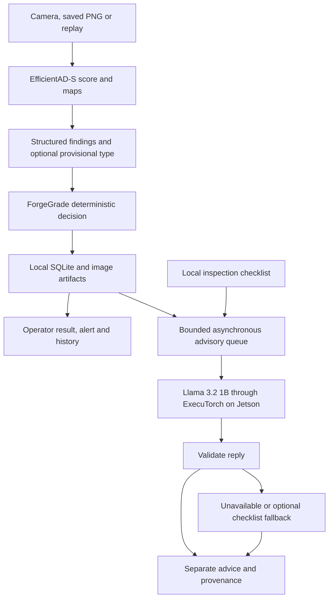

# ForgeSight


**Offline quality-inspection prototype on NVIDIA Jetson Orin Nano 8GB:** EfficientAD finds visual anomalies, deterministic rules grade the inspection, and Llama generates operator guidance on-device through ExecuTorch. Images, decisions, advice and inspection history stay local during inference.

Built for the **On-Device Quality Inspector Challenge**. MVTec AD `metal_nut` is the primary benchmark; the optional screw recipe is experimental.

**Evidence checkpoint: `081ba00`, 24 November 2026.** Offline saved-image inspection, SQLite history and real ExecuTorch Llama advice are **verified on the Jetson**. Physical-part accuracy and full acceptance of the latest combined build remain unverified. The checkpoint commit documents a partial guidance check, not a whole-station deployment.

[Features](#phase-1-feature-catalogue) · [Architecture](#architecture) ·
[Results](#data-and-measured-results) · [Setup](#get-started) ·
[Future work](#future-development) · [Submission documents](#submission-deliverables)

## Phase 1 feature catalogue

The following features exist in the current application source. This catalogue
includes optional modes and capabilities that older stage documents do not yet
describe fully. Implementation, automated checks and measured device acceptance
are distinct: the results section records the scope actually measured.

### Inspection station and operator interface

| Feature | What it does |
| --- | --- |
| Live camera preview and controls | Shows the C270 feed; Start Camera opens capture and Stop Camera releases it without discarding the saved result. |
| Capture one inspection | Analyze saves one frame and creates a structured inspection. SQLite assigns persistent `INS-000001`-style attempt IDs; repeated frames are not automatically counted as new physical parts. |
| PNG upload | Accepts RGB PNGs and, in screw mode, native grayscale PNGs from the browser computer with size/dimension limits. The original-size MVTec declaration enables provisional benchmark grading; other inputs remain diagnostic. |
| Saved dataset replay | Backend upload/replay and Jetson-copy replay endpoints validate permitted dataset references/bytes. The separate PC replay app offers an exposed-example catalog; the current Jetson page presents Camera and Upload PNG tabs. |
| Four operator views | Inspect, Results, Review and History navigation; responsive layouts, collapsible sidebar, keyboard labels, progress/busy/error feedback and saved light/dark preference. |
| Image exploration | Original, Highlighted Area, interactive Compare slider, Heatmap and Contours views; response-value legend and access to the saved original. PNG is the default overlay format; optional JPEG is lossy. These visualize model response, not confirmed damage. |

The current Camera Analyze control declares a physical part. The backend also
supports a screen-photo diagnostic source; there is no separate screen-photo
selector in the current page. Do not describe a displayed dataset photo as a
physical component. [Jetson workflow](docs/JETSON_LIVE_UI.md),
[current UI](forgesight/web/jetson_live.html), [PC app](docs/OPERATOR_APP.md).

### Detection, localization and ForgeGrade

| Feature | What it does |
| --- | --- |
| EfficientAD anomaly detection | Produces a real image score and source-resolution response maps from the frozen, calibrated model; threshold and model provenance are retained. |
| Response-region measurements | Finds connected response regions, largest/additional regions, pixel area, bounding boxes and a diagonal extent proxy. Saved benchmark nut layouts can receive approximate opening/rim/face/perimeter descriptions. |
| Metal-nut type assessment | Optional four-type profile reports bent, flip, scratch or discoloration and can abstain as `unknown`; no folder label is substituted for a prediction. |
| Screw type assessment | Separate screw tree supports `manipulated_front`, `scratch_head`, `scratch_neck`, `thread_side` and `thread_top`, with approximate head/neck/thread/tip geometry and unknown handling. |
| Deterministic decisions | ForgeGrade applies versioned PASS/REVIEW/REJECT rules and fixed next actions. Llama and operator review cannot overwrite the original grade. |
| Severity and uncertainty | Prototype pixel-response severity plus optional type-conditioned Low/Medium/High/Unassessed metadata; unknown, orientation and uncertain geometry are handled explicitly. |

Camera-domain decisions remain **REVIEW** pending validation. Pixel extent is
not calibrated millimeters or confirmed damage size. Classification reliability
and benchmark limits are reported below. [Vision evaluation](docs/VISION_EVALUATION.md),
[regions implementation](forgesight/regions.py), [type](docs/DEFECT_TYPE.md),
[severity](docs/DEFECT_SEVERITY.md), [ForgeGrade](docs/FORGEGRADE.md).

### Part plugins and recipe switching

| Feature | What it does |
| --- | --- |
| Two bundled part recipes | `metal_nut` and `screw` each bind their own detector, score policy, grade policy, classifier, guidance and dataset manifest. |
| Verified recipe loading | Checks component SHA-256, bundle paths, threshold agreement and classifier/model binding before use; mismatched or missing assets are refused. |
| Preloaded recipe switching | The optional Part Recipe selector changes routing between already-loaded vision workers while retaining the shared Llama worker. It refuses switching during inspection/recovery or to an unavailable worker. |
| Per-inspection recipe provenance | New inspections use the selected recipe; saved records retain their original recipe/evidence. Switching clears the prior latest-result display instead of relabeling it. |

Enable this mode with `--plugins-root` and both worker sockets after staging
both pinned model exports. It is an implemented **opt-in demonstration**, with
`demo_only: true` and `production_approved: false`. The registry currently names
these two parts explicitly; arbitrary plug-and-play category discovery is not
implemented. Both resident vision models consume memory, so switching speed
does not establish simultaneous resource or throughput acceptance.
[Plugin guide](docs/SCREW_PLUGIN.md), [recipe registry](forgesight/plugin_recipe.py),
[switching](forgesight/plugin_station.py), [checks](tests/test_plugin_station.py).

### ForgeAssist and grounded operator guidance

| Feature | What it does |
| --- | --- |
| Real local Llama advice | Llama 3.2 1B Instruct generates through on-device ExecuTorch/XNNPACK from saved structured inspection findings. |
| Manual and automatic modes | Default manual v5 advice is separate from opt-in reviewed-check and grounded automatic advice. Grounded mode queues eligible flagged records; normal/failed records skip generation. |
| Bounded background processing | Advice runs separately from vision; pending/busy states and deadlines prevent an unbounded request backlog. Saved grades remain available if advice fails. |
| Grounded checks and fallback | Part/type/region rules select allowed manual checks. Grounded modes validate the reply and use an identified checklist fallback for unsupported output or unavailable workers; default v5 can return ADVICE_UNAVAILABLE. |
| Saved advice provenance | Reports bind advice to the inspection and record runtime/model identity. Generated checks, host-supplied reasons and checklist fallback are distinguished. |
| Independent advisory tool | The standalone grounded-advice command reads saved evidence through a dedicated worker socket without camera access or database writes. |

These are prototype local checklists, not a factory-approved SOP retrieval
system or a verified root-cause diagnosis. [ForgeAssist](docs/FORGEASSIST.md),
[grounded advice](docs/GROUNDED_ADVICE.md), [queue](forgesight/assist_queue.py).

### Inspection history, review and reporting

| Feature | What it does |
| --- | --- |
| Persistent SQLite records | Stores original records, source references, scores, geometry, versions, decisions and advice state; exact retries are idempotent and conflicting IDs are refused. |
| Restart-safe numbering | A persistent counter is shared by captures, uploads and replays; recognized older databases migrate while retaining inspection/correction rows. |
| Browse and reopen history | Paginated station history opens original/overlay, saved advice, type/severity and operator reviews without rerunning inference. API/CLI queries additionally support filters and summaries. |
| Add and edit operator findings | Saves actor, time, finding and observation as unverified claims. Editing appends a superseding correction; original decision/evidence remain intact. |
| Hide test entries and reviews | History deletion controls hide selected entries/reviews from the operator view; they do not erase the original inspection or claim from audit storage. |
| Download inspection reports | Exports self-contained HTML with available embedded original/overlay images, outcome, saved advice and reviews. Reports are printable; the GTK WebKit desktop viewer supports Save PDF to Desktop / ForgeSight Results. |
| Recover database-save failures | Retains inspection JSON for explicit import retry when SQLite commit fails, avoiding another model forward. |

An exported **inspection report** is already implemented. The hackathon's
overall **technical report** is a separate document explaining design, runtimes,
methods, results and limits. [Storage](docs/STORAGE.md),
[history/report implementation](forgesight/history_tools.py),
[desktop viewer](scripts/jetson_desktop_launcher.py).

### Offline runtime, reliability and deployment tools

| Feature | What it does |
| --- | --- |
| Offline edge operation | **Verified on Jetson** for recorded saved-image vision, grading, SQLite, real ExecuTorch advice and loopback-service workflows with Wi-Fi disconnected. |
| Persistent inference workers | Reuses verified vision/Llama runtimes across requests; model-state reset, ready handshakes, bounded transport and explicit timeout/fallback paths are implemented. |
| Worker lifecycle and recovery | Detects worker failures, uses supported cold fallbacks, respawns/rewarms workers, drains diagnostics and releases idle/owned workers; workers follow station lifetime rather than a short-lived launch thread. |
| Operational error tracing | Rotating local logs and support IDs link request, storage and worker failures. Messages are bounded and known credential patterns are redacted. |
| Local API and validated intake | Loopback routes expose camera controls, inspection/replay/upload, advice, state, history, media and review. Mutations check origin, requests are bounded and saved media is checked against its record. |
| Storage health | Reports free disk space, low-space warnings and bounded checks for partial/unconfirmed/mismatched run directories; reports findings without deleting evidence. |
| Desktop application launcher | Starts or reuses the configured local station, checks loopback readiness, opens a dedicated Chromium/GTK WebKit window and offers desktop/menu shortcuts with local startup/browser logs. |
| Llama activation and rollback | Tooling checks the PTE/profile/export hash chain, backs up coherent assets and supports activation/rollback while the app is stopped. Runtime acceptance remains a separate check. |
| Reproducibility and diagnostics | Dataset/model fingerprints, split/exposure records, separate runtime locks, export/parity scripts, offline benchmarks and a bounded read-only diagnostic bundle collector. |

Fresh device acceptance of the newest combined build is separate from these
implemented safeguards and earlier offline proofs. [Runtime report](docs/MERGE_LATENCY_REPORT.md),
[operation log](forgesight/operation_log.py), [storage health](tests/test_storage_health.py),
[launcher](docs/JETSON_DESKTOP_LAUNCHER.md), [activation/rollback](docs/EDGE_LLAMA_ACTIVATION.md),
[diagnostic collector](forgesight_diag_collect.py).

### Recorded offline proof

- [Disconnected integrated replay pilot](manifests/jetson_offline_saved_replay_pilot_v1.json): a saved image ran through EfficientAD, ForgeGrade, SQLite and real ExecuTorch advice on the physical Jetson; network snapshots showed no upstream route or Wi-Fi/ethernet IPv4 address.
- [Offline case series](manifests/jetson_offline_case_series_v1.json): normal and anomaly-candidate saved images produced PASS/REVIEW records with exact SQLite readback; a real advisory completed during the disconnected interval.
- [Offline loopback service](manifests/jetson_offline_loopback_ui_v1.json): local page/API service, generated advice, timeout handling and UI process restart were exercised without Wi-Fi.
- [Repeated vision](manifests/jetson_offline_vision_latency_v1.json) and [advisory](manifests/jetson_offline_advice_latency_v1.json) runs supply the disconnected latency/resource measurements below.

These records establish offline operation for their tested saved-image workflows. Physical-part validation and a complete cold-start check of the newest combined source remain separate acceptance items. [Proof methods and scope](docs/STAGE10_VERIFICATION.md).

## Architecture



Vision supplies findings; **ForgeGrade owns PASS/REVIEW/REJECT and Llama cannot override it**. The JSON hand-off carries source/model provenance, score, type or uncertainty, geometry, severity and decision. Anomaly scores are not calibrated probabilities; confidence is not severity.

The default v5 advisory contract and opt-in reviewed-check/grounded guidance are separate paths. Generated wording, host-supplied reasoning and fallback retain separate provenance. Advice failures preserve the saved grade. See [records](docs/INSPECTION.md), [grading](docs/FORGEGRADE.md), [advisory integration](docs/FORGEASSIST.md) and [grounded guidance](docs/GROUNDED_ADVICE.md).

For example, the recorded `ca499bd` replay of development image `test/bent/017.png` scored **0.682808876** and received provisional benchmark REJECT. Its accepted 40-token advice left the saved decision unchanged. This is a saved-image integration example, not a physical-part result. [Recorded inspection/advice](manifests/jetson_persistent_advice_success_v1.json).

## Hardware and both runtimes

| Component | Recorded configuration |
| --- | --- |
| Device | Orin Nano 8GB, ARM64 Linux; audited Ubuntu 20.04.6, L4T 35.6.1, CUDA 11.4; Logitech C270 USB camera |
| Vision | EfficientAD-S, RGB 256 x 256, FP32 TorchScript; Jetson CPU, isolated Python 3.12.14 / Torch 2.14.0+cpu |
| Advisory | Meta Llama 3.2 1B Instruct; ExecuTorch 1.5.1+cpu / XNNPACK CPU; dynamic INT8 activations, INT4 weights/group 128, 4-bit embeddings/group 32 |
| Isolation | Separate vision and Llama runtimes under `/home/nvidia/.local/share/forgesight/`; Jetson UI/controller uses existing Python 3.8 |
| Application | Local Jetson HTTP UI; separate FastAPI PC replay UI; SQLite/local files, no CDN or cloud inference required |

A TensorRT engine was built, but GPU inference parity and speed are unverified. **The reported Jetson results use CPU inference.** See [hardware](docs/HARDWARE.md), [vision runtime](docs/JETSON_VISION.md), [Llama runtime](docs/JETSON_RUNTIME.md) and [model/export provenance](docs/EDGE_RUNTIME.md).

## Data and measured results

EfficientAD-S trained for 10,000 FP32 steps on **176 normal metal-nut images**. The frozen split assigns 44 normal-validation images, four development previews and 111 holdout images. Threshold **0.22776579856872559** was fixed before holdout evaluation. Llama uses pretrained weights and structured prompts; it was not fine-tuned.

### Frozen metal-nut anomaly benchmark

| Metric | Result |
| --- | ---: |
| Defects flagged / good images unflagged | 87/89 / 20/22 |
| Precision / recall / F1 | 97.75% / 97.75% / 97.75% |
| Accuracy | 96.40% |
| False alarms / missed defects | 2 / 2 |
| False-alarm rate on 22 good images | 9.09% |

These are saved benchmark images, not physical-camera accuracy. Both misses were scratches and received provisional PASS in the recorded diagnostic. Jetson reproduced all 111 PC candidate decisions. Ground-truth folders are not predicted classes. [Evaluation/failures](docs/VISION_EVALUATION.md), [device batch](manifests/jetson_holdout_batch_v1.json).

The opt-in four-type profile correctly labeled 17/19 defective images, abstained on two and left five good images unflagged. Its 24-image test was reused for successive candidates; its split repartitions the detector's already-exposed holdout. These are provisional subtype results, not a fresh independent test. [Classification](docs/DEFECT_TYPE.md), [severity](docs/DEFECT_SEVERITY.md), [dataset](docs/DATASET.md), [training](docs/VISION_TRAINING.md), [calibration](docs/VISION_CALIBRATION.md).

### Jetson CPU performance

| Historical disconnected test scope | n | p50 | p95 |
| --- | ---: | ---: | ---: |
| Cold vision: model forward only | 20 | 1,585 ms | 1,684 ms |
| Same cold replay: through SQLite commit | 20 | 7,499 ms | 7,677 ms |
| Cold Llama advice: native process wall | 8 | 20,690 ms | 20,942 ms |
| Vision child peak RSS | 20 | 436,336 KiB | 437,163 KiB |
| Separate advice child sampled peak RSS | 8 | 1,172,206 KiB | 1,189,735 KiB |

Vision repeated two known images; advice repeated one inspection. These separate runs do not measure simultaneous system peak memory or physical parts/minute. [Offline methods/records](docs/STAGE10_VERIFICATION.md).

At earlier persistent-runtime build `ca499bd`, one saved-image inspection took **2.337 s**, including a **1.768 s** forward but excluding SQLite, camera, UI and advice. Its first advisory request took **5.311 s**, including reported model load. These single observations have different timing scopes/prompts from the cold series: no direct speedup or warm p50/p95 claim is valid. [Runtime report](docs/MERGE_LATENCY_REPORT.md).

Application FPS, physical parts/minute, complete camera-to-advice latency, simultaneous peak RAM, power, TTFT and a comparable current-build tokens/s series are not established by these tables.

### Latest guidance and experimental screw recipe

Commit `081ba00` records guidance from source `842c793` tested on an existing warm Jetson ExecuTorch worker: **12/15 matching model choices** (metal nut 7/9, screw 5/6); three needed pinned checklist fallback. PC replay verified all 15 guarded outputs. The installed station was not upgraded/restarted. This is prompt/protocol evidence, not new accuracy, site QC approval or full deployment. [Latest record](manifests/jetson_hybrid_guidance_842c793_v1.json).

The opt-in `--plugins-root` selector adds a screw recipe. Its selected 30k development detector flagged 26/29 defects, with no false alarms on 21 good images in a reused 50-image diagnostic. Subtypes were correct in 19/25 calls, with six wrong calls, one unknown and three detector misses. The reliability gate remains failed. Nut/screw metrics are kept separate. [Screw guide](docs/SCREW_PLUGIN.md).

## Get started

```sh
git clone https://github.com/honey-cake7/ForgeSight.git
cd ForgeSight
```

Follow [setup and asset staging](docs/SETUP.md) first. Models, licensed datasets, generated outputs and databases are excluded from Git. Root `requirements.txt` installs only the early Pillow environment, not the application.

On an **already prepared Jetson**, from matching source with staged assets:

```sh
export FS_VISION="$HOME/.local/share/forgesight/vision_cpu_v1"
/usr/bin/python3 -B -m forgesight.jetson_live_ui \
  --vision-python "$FS_VISION/venv/bin/python" \
  --model "$FS_VISION/efficientad_s_calibrated.ts" --port 8770
```

Open **http://127.0.0.1:8770** on the Jetson. This uses the default manual advisory path; optional worker/grounded/plugin modes require additional flags/assets. Current-source launch was not rerun during this documentation update.

Choose Camera for a physical part or Upload PNG for saved images, then review Results, Review and History. The Camera Analyze button declares a physical part; screen-photo diagnostics require the explicit backend source mode. Request advice for an eligible flagged record, or enable grounded automatic advice as documented. SQLite assigns inspection IDs; a captured frame alone does not establish a distinct physical part. Stop with Ctrl+C. Default history: `runs/live_inspections_v1/inspections.sqlite3`, relative to the launch directory. [Jetson workflow](docs/JETSON_LIVE_UI.md), [storage](docs/STORAGE.md).

For PC/WSL replay, use the prepared app interpreter (adjust its location):

```sh
export FS_APP_PY="$HOME/.cache/forgesight/app-v1/venv/bin/python"
"$FS_APP_PY" -B -m forgesight.operator_app
```

Open **http://127.0.0.1:8765**. Default device is CUDA; add `--device cpu` to select CPU explicitly. This earlier replay UI does not automatically attach Jetson workers. [PC workflow](docs/OPERATOR_APP.md).

## Verify and explore

From the repository root in the prepared Linux/WSL app environment:

```sh
"$FS_APP_PY" -B -m unittest discover -s tests -q
"$FS_APP_PY" -B -m forgesight.data_manifest --check
```

The second command requires original data. See [setup](docs/SETUP.md) for training, export and cached-result reproduction links. Do not rerun an exposed final holdout to select a model or clear its exposure ledger. Focused PC/WSL feature checks were rerun for this catalogue; they are software checks, not new Jetson/accuracy measurements. The [audit](docs/SUBMISSION_AUDIT.md) records commands and results.

| Directory | Purpose |
| --- | --- |
| `forgesight/` | Vision, records, grading, storage, workers and local UI |
| `configs/`, `guidance/`, `plugins/` | Policies, local checks and optional recipes |
| `requirements/` | Separate app, vision, export and ARM Llama locks |
| `scripts/`, `tests/` | Verification tools and automated checks |
| `manifests/` | Experimental metadata and evidence summaries |
| `docs/` | Setup, methods, status, decisions and limitations |

## Future development

The Phase 1 foundations above already include part recipes, deterministic
grading, local guidance and operator correction records. The next work extends
those foundations in the project's stage order; it does not implement future
features as part of this documentation update.

| Order | Extension | Planned work beyond the current implementation |
| --- | --- | --- |
| 1 | ForgeTrace | Defect-rate, location and orientation trends across distinct parts/batches, with correct denominators, rolling windows and evidence-linked recurrence alerts. |
| 2 | ForgeDual | Extend the existing anomaly-plus-subtype pipeline with explicit same-domain known/unknown evaluation, held-out defect categories and measured known-only/anomaly-only/fused comparisons. Existing classifiers or two EfficientAD maps alone do not complete this evaluation. |
| 3 | ForgeGrade+ | Calibrated physical geometry, measured calibration error, reviewed critical zones and tolerance-aware policies beyond today's prototype pixel-response rules. |
| 4 | ForgeAssist+ | Approved local SOP retrieval, stronger source attribution/uncertainty and operator-usefulness evaluation beyond the current pinned checklists and reply guards. |
| 5 | ForgeLoop | Extend current append-only operator reviews into verified labels/causes, curated labeling queues and controlled training-data export; never promote model guesses to ground truth automatically. |
| 6 | Robustness and measured optimization | Glare/focus/pose/drift/unknown-defect tests, power/thermal and multi-hour runs, simultaneous memory/throughput measurements and ablations. Adopt GPU/quantized paths only after output parity and resource/latency checks. |

Additional part categories would reuse the recipe design but need their own
data, training/calibration, labels, policies, guidance, registry integration
and acceptance evidence. No zero-code category expansion or automatic model
retraining is claimed.

## Evidence limits and submission documentation

- Validate physical parts under controlled camera pose/lighting. Camera decisions remain REVIEW; no calibrated millimeters or certified industrial grades are claimed.
- Revalidate the newest combined source from a disconnected cold start. Existing saved-image offline proof is verified; the latest-build regression and physical-camera acceptance are separate checks.
- Measure camera-domain quality, throughput, simultaneous resources and missing metrics. Validate provisional subtype/severity and operator usefulness on fresh evidence and site-approved procedures.
- Link the demo video and consolidated technical report when available, and document the reviewer asset handoff and code-license decision. An absent repository link does not establish that an artifact has not been prepared elsewhere. [Submission audit](docs/SUBMISSION_AUDIT.md).

## Submission deliverables

| Deliverable | Repository entry |
| --- | --- |
| Documented source | This repository; [setup and required assets](docs/SETUP.md). A clone alone excludes models and datasets. |
| Target-device application | [Jetson operator guide](docs/JETSON_LIVE_UI.md), [desktop launcher](docs/JETSON_DESKTOP_LAUNCHER.md) and device evidence above. Current feature implementation and tested device snapshots are recorded separately. |
| Demo: detection, alerts and logging | **No video link is currently recorded here.** Add the demo file/URL to the submission package. |
| Overall technical report | [Runtime report](docs/MERGE_LATENCY_REPORT.md), [evaluation](docs/VISION_EVALUATION.md), [offline proof](docs/STAGE10_VERIFICATION.md) and this feature catalogue provide source material. Link the consolidated hackathon report separately from the app's per-inspection exports. |

The [submission audit](docs/SUBMISSION_AUDIT.md) maps records to requirements.
The supplied guide permits static, camera or recorded-video demonstrations and
sets no fixed FPS target. The project roadmap additionally requires physical-part
acceptance. When preparing the technical report, use this order: problem/scope,
Phase 1 features and workflow, architecture/plugin contracts, data/models,
both runtime/deployment paths, decision/advice safeguards, measured results and
failures, offline proof, limitations and future development.

## Attribution and licensing

MVTec AD: MVTec Software GmbH and Bergmann et al., CVPR 2019. The documented dataset license is **CC BY-NC-SA 4.0**; see [dataset acquisition/terms](docs/DATASET.md). Dataset terms and source-code licensing are separate.

Llama 3.2 uses Meta's Community License and Acceptable Use Policy; obtain publisher access and retain required notices. [Pinned sources/license references](docs/EDGE_RUNTIME.md). EfficientAD/Anomalib, PyTorch and ExecuTorch sources are credited in the [training](docs/VISION_TRAINING.md) and runtime documents. **There is currently no root code LICENSE**; do not assume a permissive license. Team attribution and distribution notices need submission review.
