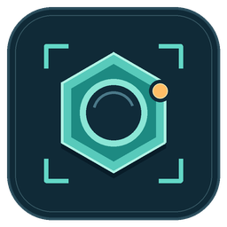
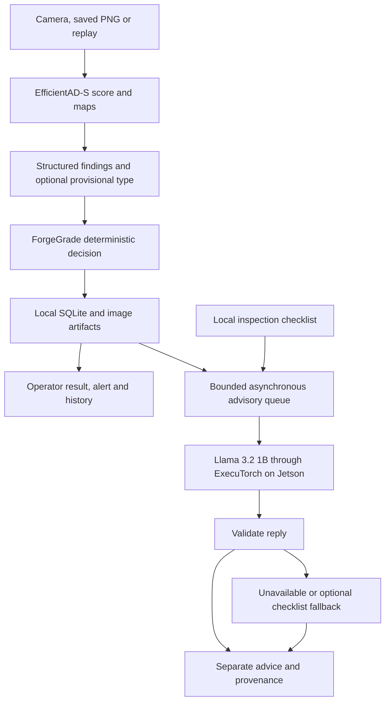

# ForgeSight AI



**Offline quality-inspection prototype on NVIDIA Jetson Orin Nano 8GB:** EfficientAD finds visual anomalies, deterministic rules grade the inspection, and Llama generates operator guidance on-device through ExecuTorch. Images, decisions, advice and inspection history stay local during inference.

Built for the **On-Device Quality Inspector Challenge**. MVTec AD `metal_nut` is the primary benchmark; the optional screw recipe is experimental.

**Evidence checkpoint: `081ba00`, 24 November 2026.** Saved-image inspection, SQLite history and real Jetson Llama generation have device evidence. Physical-part accuracy and full acceptance of the latest combined build remain unverified. The latest commit documents a partial guidance check, not a whole-station deployment.

## Submission deliverables

| Deliverable | Location and readiness |
| --- | --- |
| Documented source | This repository; [setup and required assets](docs/SETUP.md). A clone alone excludes models and datasets. |
| Target-device application | [Jetson operator guide](docs/JETSON_LIVE_UI.md); earlier snapshots have saved-image/device evidence. Latest whole-build deployment acceptance is pending. |
| Demo: detection, alerts and logging | **Missing submission link.** A real video still needs to be recorded/published and linked. |
| Technical report | [Runtime report](docs/MERGE_LATENCY_REPORT.md), [vision evaluation](docs/VISION_EVALUATION.md) and [offline ledger](docs/STAGE10_VERIFICATION.md) supply evidence; a consolidated submission report is still missing. |

The [submission audit](docs/SUBMISSION_AUDIT.md) maps records to requirements and lists gaps. The supplied guide permits static, camera or recorded-video demonstrations and specifies no fixed FPS target. Our roadmap additionally requires physical-part acceptance.

## What works today

| Capability | Implemented and observed scope |
| --- | --- |
| Detect | Frozen EfficientAD-S scores and response maps; 111-image metal-nut benchmark evaluated on PC and reproduced on Jetson. |
| Classify | Opt-in bent, flip, scratch and discoloration profile; provisional benchmark results with `unknown` abstention. Camera-domain type accuracy is unverified. |
| Severity | Deterministic pixel-response grading; optional type-conditioned Low/Medium/High/Unassessed metadata. Neither measures calibrated physical damage. |
| Alert and advise | Operator decision/action display, real ExecuTorch advice, bounded background work and explicit unavailable/fallback states. Latest hybrid results are partial. |
| Log | SQLite inspection IDs, decisions, source references, versions and advice states; accepted errors and append-only manual-review claims. Restart/readback evidence exists. |
| Offline | Disconnected saved-image vision, advice, logging and loopback-service checks for earlier snapshots. Complete latest-build offline cold-start acceptance remains open. |
| Camera | C270 preview and model-path diagnostics. Room scenes and photos displayed on a screen do not establish physical-nut inspection accuracy. |

Camera-domain decisions remain **REVIEW** pending validation. Overlays show model response, not confirmed defect masks. See [current status](docs/STATUS.md) and [requirement evidence](docs/COMPLIANCE.md).

## Architecture



Vision supplies findings; **ForgeGrade owns PASS/REVIEW/REJECT and Llama cannot override it**. The JSON hand-off carries source/model provenance, score, type or uncertainty, geometry, severity and decision. Anomaly scores are not calibrated probabilities; confidence is not severity.

The default v5 advisory contract and opt-in reviewed-check/grounded guidance are separate paths. Generated wording, host-supplied reasoning and fallback retain separate provenance. Advice failures preserve the saved grade. See [records](docs/INSPECTION.md), [grading](docs/FORGEGRADE.md), [advisory integration](docs/FORGEASSIST.md) and [grounded guidance](docs/GROUNDED_ADVICE.md).

For example, the recorded `ca499bd` replay of development image `test/bent/017.png` scored **0.682808876** and received provisional benchmark REJECT. Its accepted 40-token advice left the saved decision unchanged. This is a saved-image integration example, not a physical-part result. [Recorded inspection/advice](manifests/jetson_persistent_advice_success_v1.json).

## Hardware and both runtimes

| Component | Recorded configuration |
| --- | --- |
| Device | Orin Nano 8GB, ARM64 Linux; audited Ubuntu 20.04.6, L4T 35.6.1, CUDA 11.4; Logitech C270 USB camera |
| Vision | EfficientAD-S, RGB 256 x 256, FP32 TorchScript; Jetson CPU, isolated Python 3.12.14 / Torch 2.14.0+cpu |
| Advisory | Meta Llama 3.2 1B Instruct; ExecuTorch 1.5.1+cpu / XNNPACK CPU; dynamic INT8 activations, INT4 weights/group 128, 4-bit embeddings/group 32 |
| Isolation | Separate vision and Llama runtimes under `/home/nvidia/.local/share/forgesight/`; Jetson UI/controller uses existing Python 3.8 |
| Application | Local Jetson HTTP UI; separate FastAPI PC replay UI; SQLite/local files, no CDN or cloud inference required |

A TensorRT engine was built, but GPU inference parity and speed are unverified. **The reported Jetson results use CPU inference.** See [hardware](docs/HARDWARE.md), [vision runtime](docs/JETSON_VISION.md), [Llama runtime](docs/JETSON_RUNTIME.md) and [model/export provenance](docs/EDGE_RUNTIME.md).

## Data and measured results

EfficientAD-S trained for 10,000 FP32 steps on **176 normal metal-nut images**. The frozen split assigns 44 normal-validation images, four development previews and 111 holdout images. Threshold **0.22776579856872559** was fixed before holdout evaluation. Llama uses pretrained weights and structured prompts; it was not fine-tuned.

### Frozen metal-nut anomaly benchmark

| Metric | Result |
| --- | ---: |
| Defects flagged / good images unflagged | 87/89 / 20/22 |
| Precision / recall / F1 | 97.75% / 97.75% / 97.75% |
| Accuracy | 96.40% |
| False alarms / missed defects | 2 / 2 |
| False-alarm rate on 22 good images | 9.09% |

These are saved benchmark images, not physical-camera accuracy. Both misses were scratches and received provisional PASS in the recorded diagnostic. Jetson reproduced all 111 PC candidate decisions. Ground-truth folders are not predicted classes. [Evaluation/failures](docs/VISION_EVALUATION.md), [device batch](manifests/jetson_holdout_batch_v1.json).

The opt-in four-type profile correctly labeled 17/19 defective images, abstained on two and left five good images unflagged. Its 24-image test was reused for successive candidates; its split repartitions the detector's already-exposed holdout. These are provisional subtype results, not a fresh independent test. [Classification](docs/DEFECT_TYPE.md), [severity](docs/DEFECT_SEVERITY.md), [dataset](docs/DATASET.md), [training](docs/VISION_TRAINING.md), [calibration](docs/VISION_CALIBRATION.md).

### Jetson CPU performance

| Historical disconnected test scope | n | p50 | p95 |
| --- | ---: | ---: | ---: |
| Cold vision: model forward only | 20 | 1,585 ms | 1,684 ms |
| Same cold replay: through SQLite commit | 20 | 7,499 ms | 7,677 ms |
| Cold Llama advice: native process wall | 8 | 20,690 ms | 20,942 ms |
| Vision child peak RSS | 20 | 436,336 KiB | 437,163 KiB |
| Separate advice child sampled peak RSS | 8 | 1,172,206 KiB | 1,189,735 KiB |

Vision repeated two known images; advice repeated one inspection. These separate runs do not measure simultaneous system peak memory or physical parts/minute. [Offline methods/records](docs/STAGE10_VERIFICATION.md).

At earlier persistent-runtime build `ca499bd`, one saved-image inspection took **2.337 s**, including a **1.768 s** forward but excluding SQLite, camera, UI and advice. Its first advisory request took **5.311 s**, including reported model load. These single observations have different timing scopes/prompts from the cold series: no direct speedup or warm p50/p95 claim is valid. [Runtime report](docs/MERGE_LATENCY_REPORT.md).

Application FPS, physical parts/minute, complete camera-to-advice latency, simultaneous peak RAM, power, TTFT and a comparable current-build tokens/s series are not established by these tables.

### Latest guidance and experimental screw recipe

Commit `081ba00` records guidance from source `842c793` tested on an existing warm Jetson ExecuTorch worker: **12/15 matching model choices** (metal nut 7/9, screw 5/6); three needed pinned checklist fallback. PC replay verified all 15 guarded outputs. The installed station was not upgraded/restarted. This is prompt/protocol evidence, not new accuracy, site QC approval or full deployment. [Latest record](manifests/jetson_hybrid_guidance_842c793_v1.json).

The opt-in `--plugins-root` selector adds a screw recipe. Its selected 30k development detector flagged 26/29 defects, with no false alarms on 21 good images in a reused 50-image diagnostic. Subtypes were correct in 19/25 calls, with six wrong calls, one unknown and three detector misses. The reliability gate remains failed. Nut/screw metrics are kept separate. [Screw guide](docs/SCREW_PLUGIN.md).

## Get started

```sh
git clone https://github.com/honey-cake7/Forge_Sight.git
cd Forge_Sight
```

Follow [setup and asset staging](docs/SETUP.md) first. Models, licensed datasets, generated outputs and databases are excluded from Git. Root `requirements.txt` installs only the early Pillow environment, not the application.

On an **already prepared Jetson**, from matching source with staged assets:

```sh
export FS_VISION="$HOME/.local/share/forgesight/vision_cpu_v1"
/usr/bin/python3 -B -m forgesight.jetson_live_ui \
  --vision-python "$FS_VISION/venv/bin/python" \
  --model "$FS_VISION/efficientad_s_calibrated.ts" --port 8770
```

Open **http://127.0.0.1:8770** on the Jetson. This uses the default manual advisory path; optional worker/grounded/plugin modes require additional flags/assets. Current-source launch was not rerun during this documentation update.

Choose a source mode, inspect a saved image or capture a diagnostic, then review the response, decision and history. Request advice for an eligible flagged record. Declare displayed photos as screen-photo diagnostics. SQLite assigns inspection IDs; a captured frame alone does not establish a distinct physical part. Manual review adds an unverified claim and preserves the original decision. Stop with Ctrl+C. Default history: `runs/live_inspections_v1/inspections.sqlite3`, relative to the launch directory. [Jetson workflow](docs/JETSON_LIVE_UI.md), [storage](docs/STORAGE.md).

For PC/WSL replay, use the prepared app interpreter (adjust its location):

```sh
export FS_APP_PY="$HOME/.cache/forgesight/app-v1/venv/bin/python"
"$FS_APP_PY" -B -m forgesight.operator_app
```

Open **http://127.0.0.1:8765**. Default device is CUDA; add `--device cpu` to select CPU explicitly. This earlier replay UI does not automatically attach Jetson workers. [PC workflow](docs/OPERATOR_APP.md).

## Verify and explore

From the repository root in the prepared Linux/WSL app environment:

```sh
"$FS_APP_PY" -B -m unittest discover -s tests -q
"$FS_APP_PY" -B -m forgesight.data_manifest --check
```

The second command requires original data. See [setup](docs/SETUP.md) for training, export and cached-result reproduction links. Do not rerun an exposed final holdout to select a model or clear its exposure ledger. No fresh application test-pass count is claimed here: WSL was inaccessible during this documentation audit.

| Directory | Purpose |
| --- | --- |
| `forgesight/` | Vision, records, grading, storage, workers and local UI |
| `configs/`, `guidance/`, `plugins/` | Policies, local checks and optional recipes |
| `requirements/` | Separate app, vision, export and ARM Llama locks |
| `scripts/`, `tests/` | Verification tools and automated checks |
| `manifests/` | Experimental metadata and evidence summaries |
| `docs/` | Setup, methods, status, decisions and limitations |

## Limits and remaining work

- Validate physical parts under controlled camera pose/lighting. Camera decisions remain REVIEW; no calibrated millimeters or certified industrial grades are claimed.
- Deploy the latest combined source; verify its complete disconnected cold-start operator workflow. Earlier offline proofs do not establish that this build passed.
- Measure camera-domain quality, throughput, simultaneous resources and missing metrics. Validate provisional subtype/severity and operator usefulness on fresh evidence and site-approved procedures.
- Complete the demo video, consolidated report, reviewer-accessible asset handoff and code-license decision. [Submission audit](docs/SUBMISSION_AUDIT.md).

## Attribution and licensing

MVTec AD: MVTec Software GmbH and Bergmann et al., CVPR 2019. The documented dataset license is **CC BY-NC-SA 4.0**; see [dataset acquisition/terms](docs/DATASET.md). Dataset terms and source-code licensing are separate.

Llama 3.2 uses Meta's Community License and Acceptable Use Policy; obtain publisher access and retain required notices. [Pinned sources/license references](docs/EDGE_RUNTIME.md). EfficientAD/Anomalib, PyTorch and ExecuTorch sources are credited in the [training](docs/VISION_TRAINING.md) and runtime documents. **There is currently no root code LICENSE**; do not assume a permissive license. Team attribution and distribution notices need submission review.
