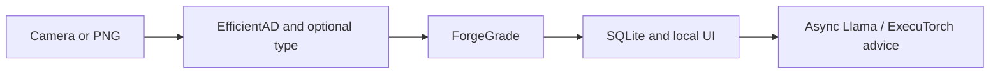

# ForgeSight


**Offline quality inspection on NVIDIA Jetson Orin Nano 8GB.** EfficientAD
finds visual anomalies, ForgeGrade applies deterministic decisions, and a
Llama-family model gives operator guidance on-device through ExecuTorch.
Images, advice and inspection history stay local during inference.

Built with Llama.

**[Watch the 2-minute demonstration](https://youtu.be/NZccgnyDJrY)** ?
[Technical report (PDF)](https://github.com/honey-cake7/ForgeSight/releases/download/v1.0.0/ForgeSight_Submission_Report_Revised.pdf)

Phase 1 includes the inspection station, metal-nut/screw recipes, guidance,
review and reporting. Recorded Jetson saved-image workflows have offline
proof. Physical-camera accuracy and newest-build acceptance remain scoped
separately in the [technical report](docs/TECHNICAL_REPORT.md).

[Setup](docs/SETUP.md) · [User guide](docs/USER_GUIDE.md) ·
[Technical report](docs/TECHNICAL_REPORT.md) · [Current status](docs/STATUS.md)

## Download and install on Jetson

Download the **[v1.0.0 reviewer application](https://github.com/honey-cake7/ForgeSight/releases/tag/v1.0.0)**.
The `.tar` contains application source, both trained vision models, the calibrated
PC checkpoint, matching Llama assets and offline ARM runtime inputs. GitHub's
**Source code** ZIP/tar.gz downloads contain source only.

**Prerequisites:** Jetson Orin Nano 8GB, Ubuntu 20.04.6 / L4T 35.6.1, system
Python 3.8.10, a graphical session, USB camera and at least **8 GiB free**.
Other JetPack versions require separate validation. Controller/viewer package
prerequisites are listed in [Setup](docs/SETUP.md#reviewer-application-install-once-then-click-forgesight).
Obtain the original **metal_nut** and **screw** datasets from
[MVTec AD](https://www.mvtec.com/research-teaching/datasets/mvtec-ad), accept the
publisher terms, and extract them into `$HOME/datasets/mvtec_ad/metal_nut/` and
`$HOME/datasets/mvtec_ad/screw/`, retaining `train`, `test` and `ground_truth`.
The installer checks the original image/mask hashes. Datasets are not bundled.
Review the model license/use policy supplied with the package.

1. Run these commands directly in a **Jetson desktop terminal** to download
   all three release assets:

```sh
mkdir -p "$HOME/Downloads/ForgeSight"
cd "$HOME/Downloads/ForgeSight"
export FS_RELEASE="https://github.com/honey-cake7/ForgeSight/releases/download/v1.0.0"
curl -fL --retry 3 -O "$FS_RELEASE/forgesight-reviewer-v1.tar"
curl -fL --retry 3 -O "$FS_RELEASE/forgesight-reviewer-v1.tar.sha256"
curl -fL --retry 3 -O "$FS_RELEASE/forgesight-reviewer-v1.tar.manifest.json"
sha256sum -c forgesight-reviewer-v1.tar.sha256
```

2. Continue only after the checksum reports **OK**. Install into a fresh
   private directory as your normal user, without sudo:

```sh
tar -xf forgesight-reviewer-v1.tar app
export FS_REVIEWER="$HOME/.local/share/forgesight/reviewer_v1"
export FS_DATA="$HOME/datasets/mvtec_ad"
/usr/bin/python3 -B app/scripts/reviewer_bundle.py install \
  --bundle forgesight-reviewer-v1.tar \
  --sha256 "$(cut -d ' ' -f 1 forgesight-reviewer-v1.tar.sha256)" \
  --prefix "$FS_REVIEWER" --dataset-root "$FS_DATA" \
  --port 8770 --camera-index 0
```

3. Wait for successful installation, then select **Allow Launching** if prompted
   and double-click **ForgeSight** on the desktop or application menu. Setup
   creates the shortcut using `forgesight/web/icon.svg`; subsequent launches need
   no terminal commands. Installation can take several minutes; cold launch
   allows up to six minutes. Terminal launch for diagnostics:

```sh
/usr/bin/python3 -B "$FS_REVIEWER/app/scripts/jetson_desktop_launcher.py" \
  --station "$FS_REVIEWER/station.json"
```

The installer preserves system Python/CUDA and refuses existing prefixes,
shortcuts or occupied ports. For a second installation, first stop any station
using the camera, choose a fresh prefix/free port and add `--no-shortcuts` to
preserve its icon. This flag creates no new shortcut. Use the normal desktop
session; `dbus-run-session` is only needed for isolated diagnostic sessions and
can produce portal/keyring warnings. [Setup and troubleshooting](docs/SETUP.md),
[device verification and checksum](manifests/reviewer_application_v1.json).

## Features

All 38 implemented feature entries are represented below. The
[user guide](docs/USER_GUIDE.md#feature-reference) explains each feature and
its optional modes; implementation does not imply production acceptance.

| Area | Included features |
| --- | --- |
| Inspection station and operator interface | Live camera preview and controls; Capture one inspection; PNG upload; Saved dataset replay; Four operator views; Image exploration. |
| Detection, localization and ForgeGrade | EfficientAD anomaly detection; Response-region measurements; Metal-nut type assessment; Screw type assessment; Deterministic decisions; Severity and uncertainty. |
| Part plugins and recipe switching | Two bundled part recipes; Verified recipe loading; Preloaded recipe switching; Per-inspection recipe provenance. |
| ForgeAssist and grounded operator guidance | Real local Llama advice; Manual and automatic modes; Bounded background processing; Grounded checks and fallback; Saved advice provenance; Independent advisory tool. |
| Inspection history, review and reporting | Persistent SQLite records; Restart-safe numbering; Browse and reopen history; Add and edit operator findings; Hide test entries and reviews; Download inspection reports; Recover database-save failures. |
| Offline runtime, reliability and deployment tools | Offline edge operation; Persistent inference workers; Worker lifecycle and recovery; Operational error tracing; Local API and validated intake; Storage health; Desktop application launcher; Llama activation and rollback; Reproducibility and diagnostics. |

The plugin selector switches preloaded `metal_nut` and `screw` recipes while
retaining the shared Llama worker. Each recipe binds its model, classifier,
policies, guidance and data hashes. Both recipes are opt-in demonstrations;
new categories require integration and their own validation.

## How it works



ForgeGrade owns PASS/REVIEW/REJECT. Advice and operator claims cannot overwrite
the original grade. Response overlays and severity describe image pixels,
not calibrated physical damage. Camera-domain decisions remain REVIEW.

Vision uses an FP32 256 x 256 TorchScript CPU export. Advice uses Llama 3.2
1B Instruct through ExecuTorch/XNNPACK with dynamic INT8 activations and INT4
weights. Separate runtimes preserve the device's system Python. The reported
measurements use CPU inference; GPU speedup has not been verified.

## Results and inference improvements

| Recorded measurement | Result and scope |
| --- | --- |
| Metal-nut detection | Precision/recall/F1 **97.75%** on 111 saved holdout images; 2 misses and 2 false alarms. Jetson reproduced PC decisions. |
| Warm vision inspection work | **2.20 s nut / 2.17 s screw**, one observation per recipe; model forward about **1.50 s**. |
| Direct warm Llama request | **1.62 s generation**, reported **28.18 decode tokens/s**; separate short worker microbenchmark. |
| Preloaded recipe switching | Mean **0.539 ms nut to screw / 0.504 ms reverse**, five server-side switches each. |
| Resident memory snapshot | **3,008 MiB used / 4,186 MiB available**; not peak memory. |
| Module input power | **8.52 W sampled peak; 6.60 W active-phase mean**, 12 saved-image attempts / 58 s, 100 ms target sampling; [measurement scope](manifests/jetson_power_measurement_v1.json). Wall power unmeasured. |

Persistent vision/Llama workers avoid repeated imports, verification and model
loading. In-process inspection avoids additional setup work, while preloaded
recipes make switching a reference change. Asynchronous advice keeps grading
separate from language generation. Resident models trade RAM for less startup
delay; the vision forward itself still takes about 1.5 s.

The supplied **~3.8 s** inspection-plus-Llama sum is an estimate from separate
measurements, not observed camera-to-advice latency. Cold/warm scopes and prompts
differ, so no controlled percentage speedup is claimed. Type/severity and the
screw diagnostic are provisional; they are not physical-camera accuracy.
See [methods, failure cases, timings and offline proof](docs/TECHNICAL_REPORT.md).

## Get started

```sh
git clone https://github.com/honey-cake7/ForgeSight.git
cd ForgeSight
```

Follow [SETUP](docs/SETUP.md) to obtain permitted model/data assets and select
the correct environment. A clone alone is not a complete runtime installation.
On an already prepared Jetson, from the matching source root:

```sh
export FS_VISION="$HOME/.local/share/forgesight/vision_cpu_v1"
/usr/bin/python3 -B -m forgesight.jetson_live_ui \
  --vision-python "$FS_VISION/venv/bin/python" \
  --model "$FS_VISION/efficientad_s_calibrated.ts" --port 8770
```

Open **http://127.0.0.1:8770** on the Jetson. Use Camera for physical parts or
Upload PNG for saved images, inspect Results, then Review or History. Plugin/
automatic-advice mode needs extra flags and both recipe assets. The PC replay
app, tests and asset checks are documented in [SETUP](docs/SETUP.md).

## Future development

| Order | Extension |
| --- | --- |
| 1. ForgeTrace | Distinct-part/batch trends, rolling defect rates and evidence-linked recurrence alerts. |
| 2. ForgeDual | Same-domain known/unknown evaluation and measured detector/classifier fusion comparisons. |
| 3. ForgeGrade+ | Calibrated geometry, measured scale error and reviewed critical-zone/tolerance policies. |
| 4. ForgeAssist+ | Approved local SOP retrieval, stronger attribution and operator-usefulness evaluation. |
| 5. ForgeLoop | Verified labels/causes, curated labeling queues and controlled training-data export. |
| 6. Robustness and optimization | Glare/pose/drift, power/thermal and multi-hour tests; measured acceleration after parity checks. |

Existing recipes, classifiers, pixel rules, checklists and review claims are
foundations for these extensions. They do not establish completed Phase 2 proof.

## Documentation and submission

| Start here | Purpose |
| --- | --- |
| [Setup](docs/SETUP.md) | Assets, environments, launch commands and tests |
| [User guide](docs/USER_GUIDE.md) | Features, operation, plugins, review and export |
| [Technical report](docs/TECHNICAL_REPORT.md) ? [PDF](https://github.com/honey-cake7/ForgeSight/releases/download/v1.0.0/ForgeSight_Submission_Report_Revised.pdf) | Architecture, datasets/models, both runtimes, measured results and limits |
| [Status](docs/STATUS.md) | Current evidence and remaining submission work |

The [reviewer application setup](docs/SETUP.md#reviewer-application-install-once-then-click-forgesight)
installs the exact vision/Llama assets and a click-to-run Jetson desktop icon.
The [release assets](https://github.com/honey-cake7/ForgeSight/releases/tag/v1.0.0)
provide the binary application; a clone alone excludes models.
[Device verification](manifests/reviewer_application_v1.json) covers a fresh private
installation, native generation, visible desktop launch and both saved-image recipes.

Submission materials include source, the target-device application, the
[two-minute demonstration](https://youtu.be/NZccgnyDJrY) and the [technical report PDF](https://github.com/honey-cake7/ForgeSight/releases/download/v1.0.0/ForgeSight_Submission_Report_Revised.pdf).
[Portable LaTeX source](https://github.com/honey-cake7/ForgeSight/releases/download/v1.0.0/ForgeSight_LaTeX_Revised.zip) is available with the release. The app's
inspection HTML/PDF exports are separate from the overall technical report.

Source is in `forgesight/`; policies/recipes in `configs/`, `guidance/`, `plugins/`;
locks in `requirements/`; checks in `scripts/`, `tests/`; evidence in `manifests/`.
Detailed development records are in the [archive](docs/archive/README.md).

MVTec AD is attributed to MVTec Software GmbH / Bergmann et al., CVPR 2019,
with the recorded CC BY-NC-SA 4.0 terms. Llama has Meta's Community License and
Acceptable Use Policy. Dataset/model terms are separate from project code;
no root code LICENSE is currently supplied. See the report for source references.
