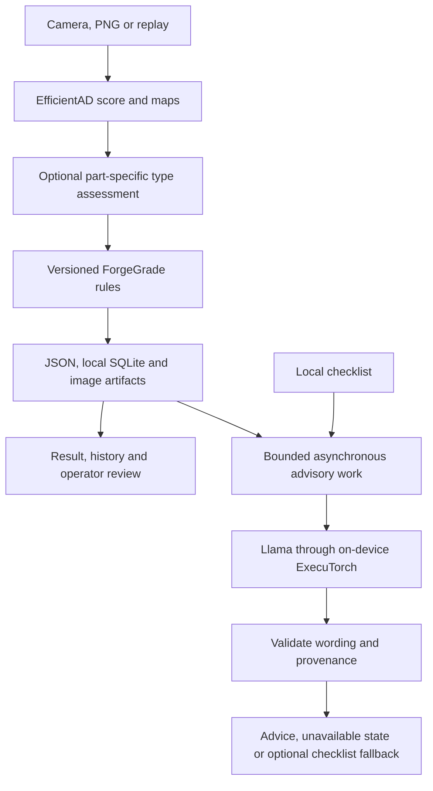

# ForgeSight technical report

Consolidated on 25 November 2026 from the repository's implementation and
recorded experiments. This describes Phase 1 functionality and the scope of
its evidence, including the separately scoped 25 November module-power test.
No new training is claimed.

## Problem and scope

ForgeSight assists an operator inspecting metal components on a Jetson Orin
Nano 8GB. It detects visual anomalies, attaches provisional type/severity,
applies deterministic decisions, stores inspections and generates local Llama
guidance. Metal nuts are the primary MVTec AD benchmark; screws use a separate
opt-in recipe. Camera scenes and benchmark images have different validation
scope. The operator workflow is in [USER_GUIDE](USER_GUIDE.md).

## Architecture and inspection contract

The structured record carries inspection/part IDs, UTC time, input mode,
source/model hashes, score, type status, geometry, decision, advice state,
artifacts, errors and timings. The system writes inspection JSON before SQLite;
success requires database commit. Exact retries are idempotent, conflicting IDs
are refused, and accepted processing failures can persist ERROR/REVIEW with a
support ID. A restart-safe counter reserves attempt IDs; it cannot identify
whether two images show the same physical component.

Original grades and evidence remain unchanged by advice or review. Corrections
are append-only operator claims; editing supersedes a claim and history deletion
hides entries rather than erasing audit data. HTML/PDF exports are individual
inspection reports, separate from this project report.

## Hardware, models and both runtimes

| Component | Recorded configuration |
| --- | --- |
| Target | NVIDIA Jetson Orin Nano 8GB, ARM64; audited Ubuntu 20.04.6 / L4T 35.6.1, CUDA 11.4; Logitech C270 |
| Vision | EfficientAD-S, 256 x 256 RGB, FP32 TorchScript on CPU; isolated Python 3.12.14 / Torch 2.14.0+cpu |
| Advisory | Meta Llama 3.2 1B Instruct through ExecuTorch 1.5.1+cpu / XNNPACK CPU |
| Quantization | Dynamic INT8 activations / INT4 weights, group 128; 4-bit embeddings, group 32 |
| Application | Existing Python 3.8 Jetson controller and local HTTP UI; separate desktop FastAPI replay application; SQLite |
| Environments | Independent vision and Llama prefixes under `~/.local/share/forgesight/`; desktop/export/ARM locks have distinct targets |

Llama uses pretrained weights and structured prompts, without project-specific
fine-tuning. Profile/export/tokenizer/source-asset hashes must form a coherent
bundle. The optional activation tool backs up and swaps a checked PTE/profile/
export trio while the app is stopped; runtime acceptance follows separately.
A TensorRT engine was built, but GPU inference parity/speed was not verified.
All timing results below are CPU results. [Hardware evidence](HARDWARE.md),
[device installation](../manifests/jetson_runtime_installation_v1.json).

## Data, fitting and calibration

The frozen metal-nut manifest assigns **176 normal fit images**, **44 normal
validation images**, **four development previews** and **111 holdout images**.
EfficientAD-S trained for 10,000 FP32 steps. Normal validation calibrated maps
and fixed image threshold **0.22776579856872559** before holdout evaluation.
The score is an anomaly response, not a probability or physical quality grade.

The opt-in metal-nut classifier uses a small forest over appearance/response
features, with abstention for weak agreement. Its 66/21/24 subtype partition
reuses the detector's already-exposed holdout; successive candidates reused
the 24-image test. Therefore type results are provisional, not a fresh
independent final evaluation.

The screw recipe uses its own data/splits, 30,000-step development detector,
CPU-native threshold **0.2372681200504303** and a five-label tree. Its labels are
`manipulated_front`, `scratch_head`, `scratch_neck`, `thread_side`, `thread_top`.
Data and scores are not combined with the metal-nut benchmark.

## Decisions, severity and advisory safeguards

ForgeGrade owns PASS/REVIEW/REJECT using versioned policies. Geometry measures
thresholded model-response pixels: connected regions, area, boxes and a diagonal
extent proxy. Approximate nut zones apply only to suitable saved benchmark
layouts. These are not confirmed defect masks, scratch lengths or calibrated
millimeters. Camera-domain outcomes stay REVIEW until validated.

The optional type-conditioned severity policy supplies Low/Medium/High or
Unassessed from relative response extent and approximate location. Flip is an
orientation issue; unknown types, invalid geometry and uncertain extents can
remain Unassessed. Confidence is not severity. Prototype severity metadata does
not override the authoritative grade.

Default API/CLI v5 composed advice differs from reviewed-check/grounded paths.
The current UI's single manual button sends `auto`; the server chooses composed
for unassessed records or `vision_choice` for a supported assessment/profile,
and refuses unsupported combinations. Grounded modes pass saved findings and permitted local checks to Llama, validate
the reply, and identify checklist fallback when needed. Default v5 can return
ADVICE_UNAVAILABLE. Normal/failed records skip automatic generation. Bounded
queues, deadlines and separate workers preserve the inspection if advice fails.
Generated checks, host-supplied reasons and fallback retain separate provenance.
These are prototype checklists, not approved factory SOP retrieval or verified
root-cause diagnosis.

## Part recipes and runtime optimization

Each recipe binds a model, score/grade policies, classifier, guidance and data
manifest. Registry checks enforce hashes, contained paths and agreement between
thresholds/models. The selector switches already-loaded vision-worker references
under a lock, retains the shared Llama worker and refuses busy/dead-worker
switches. Existing records retain their original recipe. The registry explicitly
supports `metal_nut` and `screw`; it is not arbitrary folder discovery.

Latency improvements come from reusing loaded vision/ExecuTorch runtimes,
avoiding repeated imports/model verification/loading, executing supported
inspection work in process, and preloading both recipes. Llama request state is
reset between calls. Asynchronous advice reduces operator waiting without
accelerating the vision forward itself. Resident models trade RAM for less
setup delay. Worker recovery, bounded transport, idle/parent-lifetime cleanup,
rotating logs and storage-health checks support the station.

## Detection and type results

| Evaluation | Recorded result | Scope |
| --- | --- | --- |
| Frozen metal-nut detection, 111 images | TP 87, TN 20, FP 2, FN 2; precision/recall/F1 **97.75%**, accuracy **96.40%** | Original saved-image holdout; Jetson reproduced all PC candidate decisions |
| Normal false-alarm rate | **9.09%**, 2/22 good images | Small normal set; not a physical-camera estimate |
| Metal-nut four-type profile | **17/19** defective images correct, two unknown; five good images unflagged | Reused 24-image subtype test |
| Screw detection diagnostic | **26/29** defects flagged; **0/21** good false alarms | Reused 50-image development diagnostic; recall target not passed |
| Screw subtype diagnostic | **19/25** correct calls; six wrong calls, one unknown, three detector misses | 29 exposed defective images; not fresh acceptance |
| Latest recorded hybrid prompts | **12/15** model choices matched, three checklist fallbacks; 15 guarded outputs passed PC replay | Existing Jetson worker; prompt/protocol check, not new accuracy or station upgrade |

Both metal-nut detection misses were scratches and received provisional PASS
in the recorded diagnostic. Those failures remain in the result. The classifier,
severity and physical-camera domains need fresh validation before stronger
claims. Evidence: [detector evaluation](../manifests/efficientad_s_evaluation_v1.json),
[Jetson batch](../manifests/jetson_holdout_batch_v1.json),
[four-type profile](../manifests/mvtec_four_type_v1.json),
[screw diagnostic](../manifests/screw_cpu_bundle_diagnostic_30k_v3.json),
[hybrid prompts](../manifests/jetson_hybrid_guidance_842c793_v1.json).

## Jetson performance and resources

The supplied report is timestamped **24 November 2026, 05:35:53 UTC**. Its raw
JSON remains cited on the device and the deployed commit is unpinned. Values
are attributed observations, not a benchmark rerun during consolidation.

| Warm observation | Metal nut | Screw |
| --- | ---: | ---: |
| Model forward, n=1 each | 1,500.12 ms | 1,489.37 ms |
| Inspection work, n=1 each | **2,197.57 ms** | **2,174.97 ms** |
| Server recipe switch, mean of 5 in each direction | Nut to screw: **0.539 ms** | Screw to nut: **0.504 ms** |

The nut is a development replay; screw is a diagnostic upload with unverified
original identity. The inspection timer stops before JSON/SQLite writes and
excludes camera, browser and advice. Switch timings exclude HTTP/UI/startup.

A separate warm direct Llama request took **1,622.65 ms** for generation and
**1,627.30 ms** round-trip, reporting **28.18 decode tokens/s**, 24 prompt tokens
and 39 native generated tokens. The native count excludes the first token from
prefill. The source labels **237 ms** prefill as TTFT; first-token display timing
was not independently checked. This short prompt is not the complete saved-record
advisory flow. Its **approximately 3.8 s** sum with inspection work is an estimate,
not measured camera-to-advice latency.

The supplied resident-station snapshot reports **3,008 MiB used**, **4,186 MiB
available**, **498 MiB swap used**. It describes both vision models and Llama
resident, but does not measure peak memory or thrashing. **25 W is a configured
power mode**, separate from the measured module input watts below. [Structured timing summary](../manifests/jetson_timings_summary_v1.json),
[full timing interpretation](archive/2026-11-25/JETSON_TIMINGS.md).

A separate **25 November 2026** power test sampled INA3221 **VDD_IN** at a
100 ms target interval: **584 samples / 58.07 s**, with live C270 preview and
resident vision/Llama workers. Across 12 saved-image attempts (six per recipe),
active-phase sample mean was **6.60 W** and highest sampled input was **8.52 W**
(4,976 mV x 1,712 mA). Same-run preview-only mean was **4.16 W**; a separate
30 s preview window averaged **5.46 W**, showing resting-window variability.
Whole-window mean including baseline/settling was 5.96 W.

Two sequential attempts per recipe were followed by four back-to-back attempts
per recipe while preceding advice was pending; concurrent threads were not
independently verified. Six metal-nut reports confirm real Llama generation
(1.87-2.79 s) with unapproved-output fallback; all 12 advisory reports were
CHECKLIST_FALLBACK. Screw reports omit generation duration/reason. This test
establishes power under that actual workload, not accepted-advice quality.
The running release had no Git metadata; four source-file hashes were recorded
and unchanged. The original screw recipe was restored, with preview/workers ready.

Voltage/current reads estimate total module input; subrails must not be added.
This is not wall/whole-carrier consumption, absolute transient maximum,
energy per inspection or long-duration thermal acceptance. Settings/packages
were unchanged and SSH remained connected. [Power manifest, provenance and local
raw-trace hashes](../manifests/jetson_power_measurement_v1.json).

Historical disconnected cold series measured vision-forward p50/p95
**1,585/1,684 ms** (n=20), replay-to-SQLite **7,499/7,677 ms** (n=20), and native
advice process wall **20,690/20,942 ms** (n=8). An earlier first persistent request
took **5.311 s**, including reported model loading. Different scopes/prompts
prevent a controlled percentage speedup claim. [Historical runtime analysis](archive/2026-11-25/MERGE_LATENCY_REPORT.md).

## Offline proof and remaining acceptance

Recorded physical-Jetson checks include disconnected integrated saved-image
inspection/advice, normal/anomaly case readback, loopback page/API service,
timeouts, process restart and failure recovery. Network samples observed no
upstream route or Wi-Fi/ethernet IPv4 during the tested intervals. These verify
offline operation for their recorded workflows; they do not transfer every
claim to a newer untested build.

Physical-part camera accuracy, a complete newest-build disconnected cold start,
full camera-to-displayed-advice percentiles, application FPS/parts throughput,
simultaneous peak resources, wall power and worst-case power remain separate acceptance
items. Camera room scenes and displayed photos are diagnostics. No factory
SOP approval, certified grading or general industrial reliability is claimed.
[Integrated offline pilot](../manifests/jetson_offline_saved_replay_pilot_v1.json),
[offline cases](../manifests/jetson_offline_case_series_v1.json),
[loopback service](../manifests/jetson_offline_loopback_ui_v1.json),
[full historical ledger](archive/2026-11-25/STAGE10_VERIFICATION.md).

## Reproducibility

Use [SETUP](SETUP.md) for current assets, locks and launch commands. Preserve
model hashes and holdout exposure records. Existing detailed methods remain
available as archived snapshots:

- [Dataset/provenance](archive/2026-11-25/DATASET.md), [training](archive/2026-11-25/VISION_TRAINING.md),
  [calibration](archive/2026-11-25/VISION_CALIBRATION.md), [cached evaluation](archive/2026-11-25/VISION_EVALUATION.md).
- [Llama export](archive/2026-11-25/EDGE_RUNTIME.md), [ARM runtime](archive/2026-11-25/JETSON_RUNTIME.md),
  [vision export/parity](archive/2026-11-25/JETSON_VISION.md), [model activation/rollback](archive/2026-11-25/EDGE_LLAMA_ACTIVATION.md).
- [All historical documents and source map](archive/README.md). Evidence manifests,
  runtime policies and binaries were not changed by documentation consolidation.

## Attribution and development direction

MVTec AD is attributed to MVTec Software GmbH / Bergmann et al., CVPR 2019;
the recorded license is CC BY-NC-SA 4.0. Llama 3.2 uses Meta's Community License
and Acceptable Use Policy. Dataset/model terms are separate from project code;
no root code LICENSE is currently supplied. Upstream training/runtime sources
and pinned model revision are recorded in the archived methods above.

Next extensions follow ForgeTrace, ForgeDual, ForgeGrade+, ForgeAssist+,
ForgeLoop and robustness/optimization in that order. Existing recipes,
classifiers, pixel rules, checklists and operator claims are foundations;
cross-part trends, validated unknown-defect fusion, calibrated tolerances,
approved SOP retrieval and verified-label training loops are future work.
